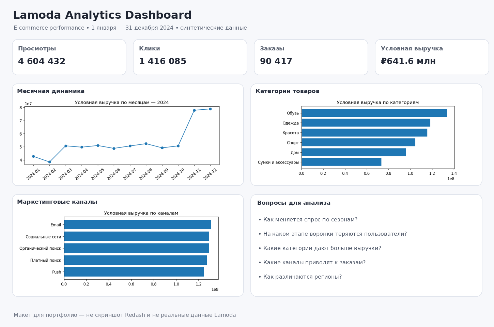

# Lamoda Analytics Dashboard — 2024

Учебный e-commerce аналитический проект на PostgreSQL, SQL и Redash.

> **Важно:** независимый учебный проект. Все данные синтетические, не получены от Lamoda и не отражают реальные показатели компании.

## Цели
- Анализировать просмотры, клики, добавления в корзину и заказы.
- Исследовать условную выручку и конверсию.
- Сравнивать категории, регионы и каналы.
- Изучать сезонность по месяцам 2024 года.
- Проверять качество данных SQL-запросами.

## Структура
- `data/` — CSV с синтетическими данными.
- `sql/` — создание таблиц, KPI, динамика, категории, регионы, топ товаров, каналы и проверки.
- `docs/metrics.md` — определения метрик.
- `screenshots/` — визуальный макет и графики.

## Запуск PostgreSQL
1. Создайте базу: `createdb lamoda_analytics`
2. Создайте таблицы: `psql -d lamoda_analytics -f sql/01_create_tables.sql`
3. В интерактивном `psql` из корня проекта выполните команды из `sql/00_load_csv_example.sql`. При необходимости укажите абсолютные пути.
4. Запустите проверки: `psql -d lamoda_analytics -f sql/08_data_quality_checks.sql`
5. Выполните запросы `sql/02_...sql` — `sql/07_...sql`.

## Redash
1. Подключите PostgreSQL как Data Source в доступном экземпляре Redash.
2. Создайте запросы из файлов `sql/02_kpi_metrics.sql` — `sql/07_channel_analysis.sql`.
3. Создайте визуализации: Number/KPI для `02`, Line Chart для `03`, Bar Chart для `04`, Bar Chart/Table для `05`, Table для `06`, Bar Chart для `07`.
4. Добавьте графики на дашборд **Lamoda Analytics — 2024**.
5. Сохраните скриншоты реального Redash в `screenshots/`.

## Визуальный пример
`dashboard_mockup.png` — концептуальный макет, не скриншот работающего Redash и не реальные данные Lamoda.

## Пример описания в резюме
Разработала учебный e-commerce analytics проект на PostgreSQL и Redash: подготовила SQL-запросы для анализа воронки просмотров, кликов, корзины и заказов; исследовала динамику выручки, категории, регионы и каналы; задокументировала метрики и добавила проверки качества данных. Использовала синтетические данные за 2024 год.

Указывай только те задачи, которые действительно выполнила и можешь объяснить на собеседовании.
